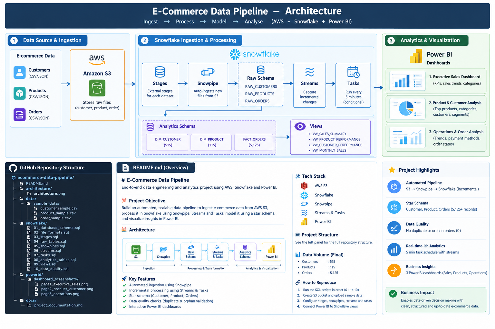

# E-Commerce Data Pipeline | AWS S3, Snowflake & Power BI

An end-to-end data analytics engineering portfolio project demonstrating cloud data ingestion, automated incremental loading, SQL transformations, data quality validation, and business intelligence reporting.

## Architecture



## Technology Stack

* **Cloud storage:** Amazon S3
* **Data warehouse:** Snowflake
* **Data ingestion:** Snowpipe with automatic ingestion
* **Incremental processing:** Snowflake Streams and Tasks
* **Data modeling:** Fact and dimension tables
* **Business intelligence:** Power BI
* **Version control:** Git and GitHub

## Pipeline Overview

1. Store initial and incremental CSV files in Amazon S3.
2. Ingest incremental files into Snowflake using Snowpipe.
3. Capture new data with Snowflake Streams.
4. Process changes through scheduled Tasks.
5. Load customer and product dimensions and the order fact table.
6. Validate records and relationships with SQL data-quality checks.
7. Analyze sales, products, customers, and orders in Power BI.

## Data Volume

| Table        | Final row count |
| ------------ | --------------: |
| DIM_CUSTOMER |             515 |
| DIM_PRODUCT  |             115 |
| FACT_ORDERS  |           5,125 |
| **Total**    |       **5,755** |

These are the recorded project results. The total is the sum of the three tables, not a count of unique entities across all tables.

## Power BI Dashboard

The report contains three pages:

1. Executive Sales Dashboard
2. Product & Customer Analysis
3. Operations & Order Analysis

The report connects to Snowflake and uses customer and product dimensions, the orders fact table, and analytical views.

## Data Quality

The recorded final validation included:

* No duplicate order IDs
* No orphan orders
* Checks for invalid quantities and discount values
* Reconciliation of gross sales, discounts, and net sales

## Repository Structure

```text
ecommerce-data-pipeline/
├── architecture/
│   └── architecture.png
├── data/
├── docs/
├── powerbi/
├── snowflake/
│   ├── 01_database_schema.sql
│   ├── 02_file_formats.sql
│   ├── 03_stages.sql
│   ├── 04_raw_tables.sql
│   ├── 05_snowpipes.sql
│   ├── 06_streams.sql
│   ├── 07_tasks.sql
│   ├── 08_analytics_tables.sql
│   ├── 09_views.sql
│   └── 10_data_quality.sql
├── .gitignore
└── README.md
```

## Security

Credentials, private keys, environment files, and Power BI report files are excluded through `.gitignore`. Do not commit credentials, account identifiers that should remain private, or sensitive business data.

## Future Improvements

* Add automated pipeline monitoring and failure alerts.
* Add stronger duplicate handling and retry controls.
* Add automated tests for transformations and data quality.
* Document deployment and recovery procedures.
